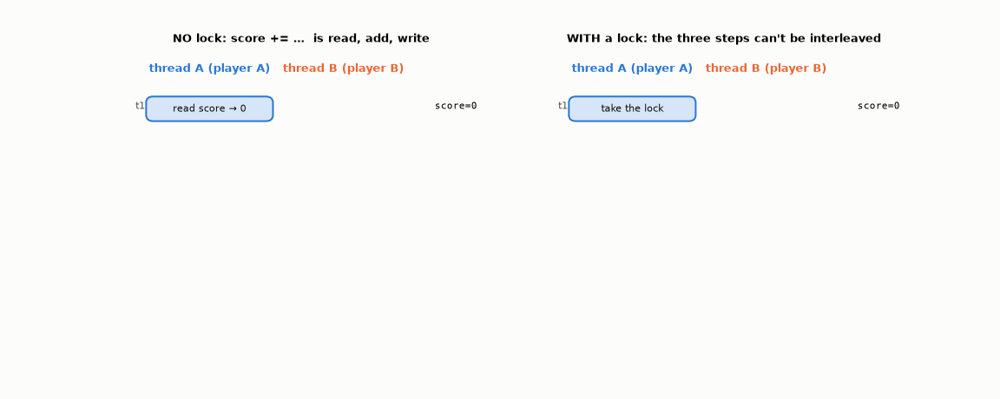
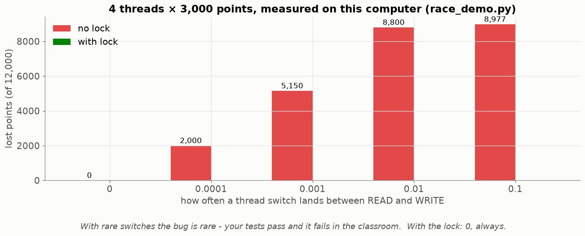
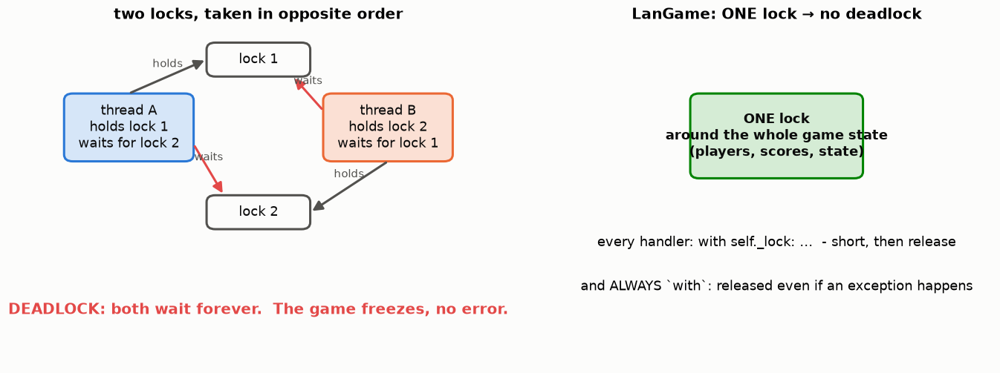
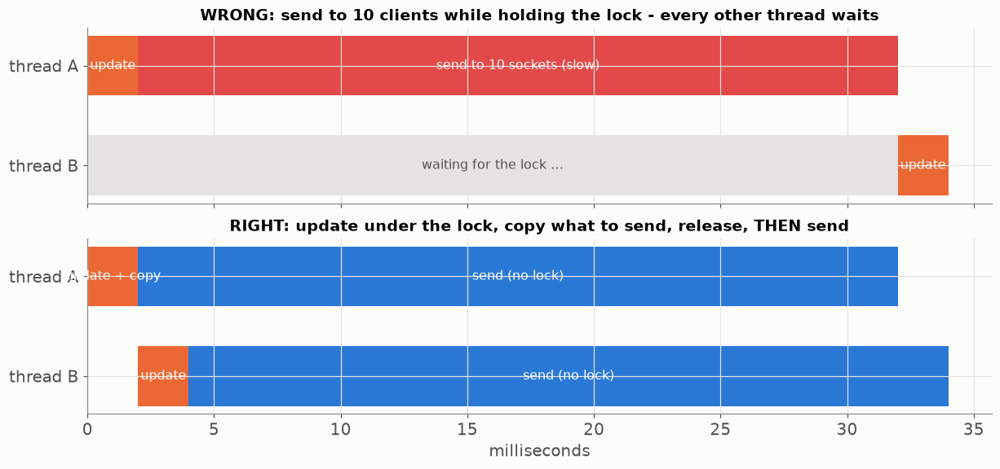
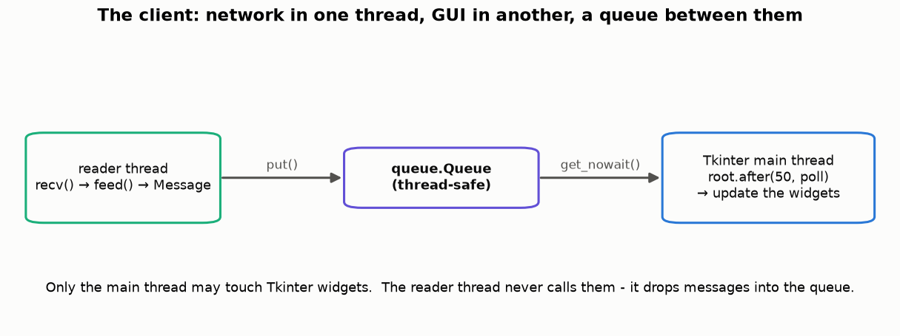

# Lesson 32 — Threads, race conditions and locks

> **For:** Liraz (LanGame — server and client) · Ryan (camera thread, Lesson 26) · Eran/Liraz (SQLite and threads)
> **Time:** 45 – 60 min &nbsp;·&nbsp; **Before:** Lesson 31 &nbsp;·&nbsp; **After this:** Lesson 33 (the database)

## 🎯 By the end, the student can

1. Explain why the server needs threads (blocking `recv()`), and name LanGame's threads.
2. Show a **race condition** step by step and reproduce one live.
3. Fix it with a `Lock` and `with`, and explain the critical section.
4. Explain deadlock, why LanGame uses **one** lock, and why the lock must be held **briefly**.
5. Explain why only Tkinter's main thread may touch widgets (the queue).

---

## 1. Why threads at all

`conn.recv()` **blocks**: it waits until bytes arrive. One loop serving 4 players would sit waiting on player 1 while
player 2's answer piles up. So: **one thread per client** (`ClientHandler`), plus the accept loop, plus `Timer` threads
that close a question after 15 s. They all share **one** game state — in memory, fast, and dangerous.

## 2. The race condition — step by step



`score += 800` is **three** steps: read, add, write. If thread B reads between A's read and A's write, A's 800 is
overwritten — **lost**. The result depends on timing → a **race condition**. Python's GIL does **not** protect you: it
keeps one *bytecode* at a time, and `+=` is several.

## 3. See it happen

```bash
cd lessons/32_threads_locks
python race_demo.py          # 4 threads × 10,000 points without a lock → thousands lost
python race_demo.py --lock   # 40,000 every time
```



When a switch between READ and WRITE is **rare**, the bug is rare — your tests pass, and it fails in front of the class.
That's the worst kind of bug. The lock makes it **0, always**.

## 4. The lock

```python
with self._lock:                      # take it (wait if another thread has it)
    player.score += points            # critical section: one thread at a time
                                      # released here - even if an exception was raised
```

* **Critical section** = the code between take and release.
* Always `with`: forgetting to release = every other thread waits forever.

## 5. Deadlock — and LanGame's simple rule



Two locks taken in opposite orders → each thread holds one and waits for the other → frozen, with no error. LanGame
uses **one lock** around the whole game state: no ordering to get wrong.

## 6. Hold it briefly



Sending to 10 sockets while holding the lock makes every handler wait. Do the update **and copy** what must be sent
under the lock; release; then send.

## 7. Threads and Tkinter



Tkinter is single-threaded: only the main thread may touch widgets. The client's reader thread puts messages into a
`queue.Queue`; the GUI polls it with `root.after(50, poll)`. (Same idea as Ryan's camera thread, Lesson 26.)

**SQLite and threads:** a connection may be used only by the thread that created it → one connection per thread (or
per operation); `Database.get_connection()` handles this (Lesson 33).

## 8. Misconceptions

| Student says | Truth |
|---|---|
| "Python has the GIL, so I don't need locks" | The GIL protects bytecodes, not your three-step update. |
| "The tests passed, so there's no race" | Races depend on timing — they hide from tests. Reason about them, and test with the demo. |
| "More locks = safer" | More locks = deadlock risk. One lock, held briefly. |
| "The reader thread can update the label directly, it works" | Until it doesn't — Tkinter is not thread-safe. Use the queue. |

## 9. Activities

1. **Two students, one whiteboard (10 min).** Both must add their number to the total on the board: read it, walk to the
   calculator, come back, write. Start them together → a lost update. Now add a "lock" (a marker only one may hold).
2. **Run both demos** and change `THREADS`, `ADDS`.
3. **Find the critical sections (10 min).** In `GameEngine`, list every method that touches `players` or `state` — each
   must be inside `with self._lock:`.

## 10. Check yourself

<details><summary>1. Score 0. A adds 300, B adds 200, both without a lock. Which final scores are possible?</summary>

500 (no overlap), 300 (B's write lost), 200 (A's write lost).
</details>

<details><summary>2. Why is `with lock:` better than `lock.acquire()` … `lock.release()`?</summary>

If an exception happens in between, `release()` is never called → deadlock. `with` releases in every case.
</details>

<details><summary>3. The timer thread closes the question while a handler thread records an answer. What protects the state?</summary>

Both run their changes under the same lock, so one completes before the other starts; and the FSM check (`state ==
QUESTION`) inside the lock decides whether the answer still counts (Lesson 30).
</details>

## 11. In your project

| Project | Where |
|---|---|
| LanGame | `langame/server/game_engine.py` (one `self._lock`) · `server/client_handler.py` (one thread per client) · `server/game_server.py` → `serve_forever`, `broadcast` · `client/network_client.py` → `_reader_loop` · `client/controllers/client_controller.py` → `_poll_inbox` · `database/db.py` → `get_connection` · theory `05_LanGame/01_theory/04_threads.md` · notebook `02_threads_and_locks.ipynb` |
| FaceEmotion | `app/vision/camera.py` (Lock + copy) |

## 🎬 Watch & explore

* *Race conditions and mutexes explained* — [search on YouTube](https://www.youtube.com/results?search_query=race+condition+mutex+lock+explained)
* Python docs — [`threading` — Lock objects](https://docs.python.org/3/library/threading.html#lock-objects) and [`queue`](https://docs.python.org/3/library/queue.html)
* *The Deadlock Empire* — [deadlockempire.github.io](https://deadlockempire.github.io/) (a game: you are the scheduler and must break the program)
