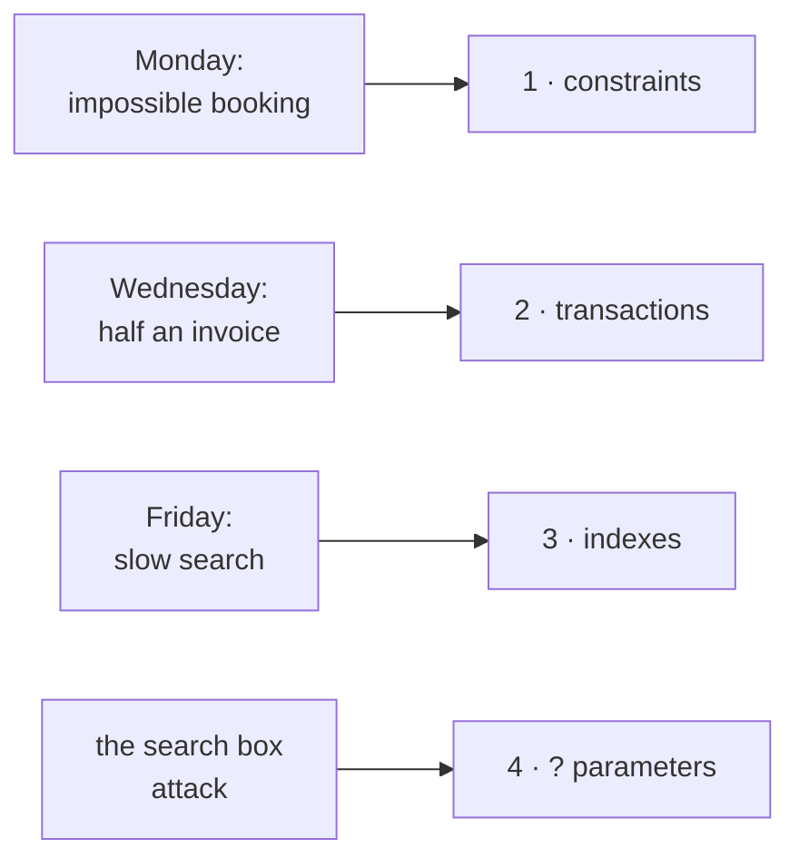
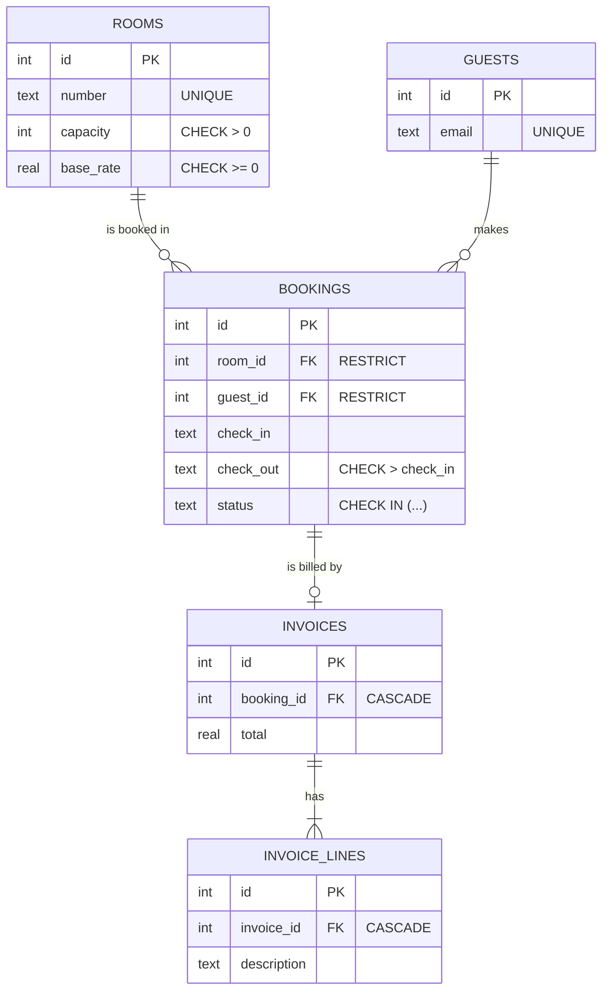
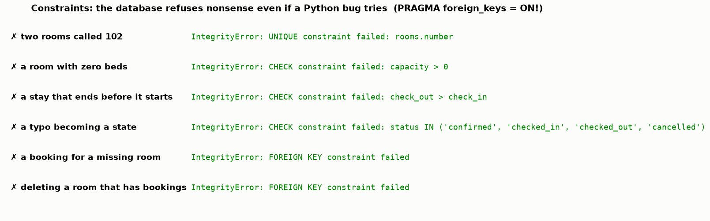
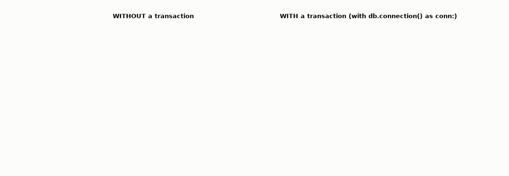
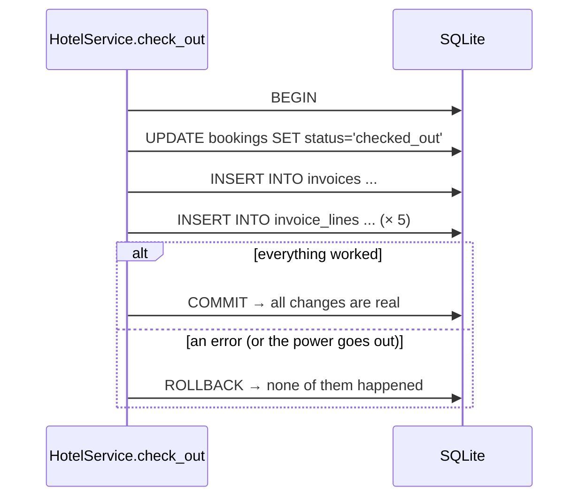
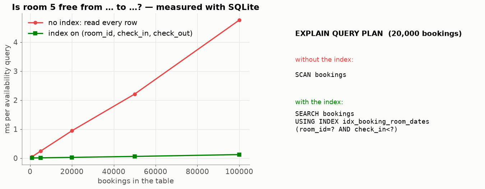
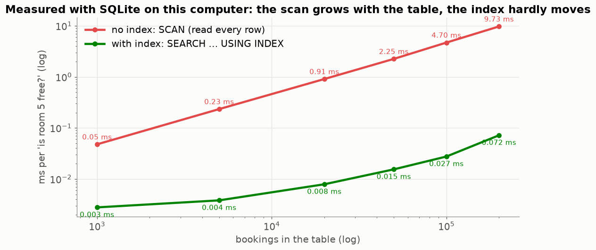
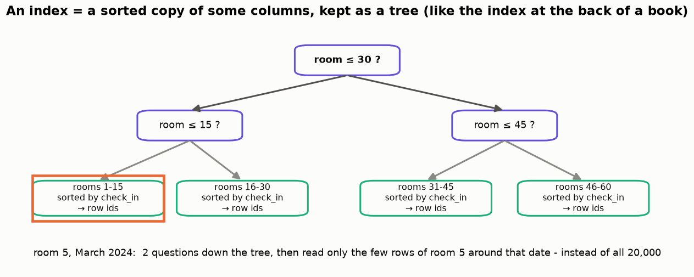
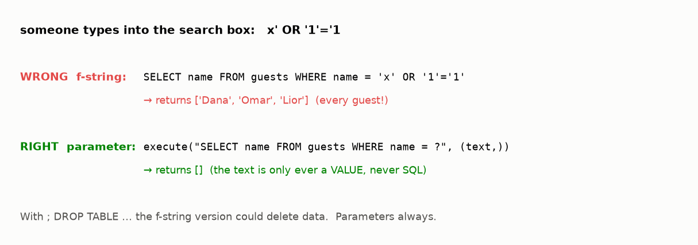

# Lesson 33 — The database: constraints, transactions, indexes, parameters

> **For:** Eran (HotelManager) · Liraz (LanGame) · every project with SQLite &nbsp;·&nbsp; **Time:** 2 × 45 min
> **Before:** basic SQL (SELECT, INSERT, WHERE) &nbsp;·&nbsp; **After this:** the database chapter of the book

**In one sentence:** let the database itself refuse bad rows (constraints), group changes so they happen all-or-nothing
(transactions), find rows without reading them all (indexes), and never paste user text into SQL (parameters).

## 🗺️ The map of this lesson



## The story

> Three bad days at the hotel:
>
> 1. **Monday:** a bug in the program saves a booking that **ends before it starts** (check-out 2 March, check-in 9 March).
>    Reports go crazy.
> 2. **Wednesday:** during a guest's check-out the power goes out. The booking says "checked out", but the invoice has only
>    **half its lines**. The guest is billed wrong.
> 3. **Friday:** the hotel has 100,000 old bookings; checking "is room 5 free?" now takes so long that the receptionist waits.
>
> Plus, a student types `x' OR '1'='1` into the guest search box and sees **every guest's** details. This lesson gives one
> database tool for each problem: **constraints**, **transactions**, **indexes** and **parameters**.

### 🌍 Real world

* **Banks** run every transfer as a transaction — money leaves one account **and** arrives in the other, or neither happens.
* **Every phone has SQLite inside**: your contacts, messages and browser history are SQLite databases — it is one of the most
  used pieces of software in the world.
* **SQL injection** is still one of the most common ways websites get hacked; the famous xkcd cartoon "Bobby Tables" is about
  a school that lost its student table to it.

## Words you need

| word | meaning |
|---|---|
| **table, row, column** | like a spreadsheet: a table of rows (records) and columns (fields) |
| **primary key** | a column with a unique id for each row |
| **foreign key** | a column that must point to an existing row of another table (`room_id` → rooms) |
| **constraint** | a rule the **database itself** enforces: refuse rows that break it |
| **transaction** | a group of changes that happen **all together or not at all** |
| **commit / rollback** | make the group real / throw the whole group away |
| **index** | a sorted copy of some columns, so searches don't read every row |
| **query plan** | how SQLite will run a query: `SCAN` (read everything) or `SEARCH … USING INDEX` |
| **SQL injection** | text typed by a user becomes part of the SQL command |
| **parameter (`?`)** | a placeholder: the value is sent separately and is never treated as SQL |

---

## 0. Eran's tables at a glance



## 1. Constraints — the database says no (Monday's problem)



Every line above is a real `IntegrityError` from this lesson's script: the database **refuses** the bad row.

| constraint | prevents |
|---|---|
| `PRIMARY KEY` | two rows with the same id |
| `UNIQUE` | two rooms called "102", the same guest entered twice |
| `CHECK (check_out > check_in)` | a stay that ends before it starts — Monday's bug |
| `CHECK (status IN (...))` | a typo ("confimed") becoming a state |
| `REFERENCES rooms(id) ON DELETE RESTRICT` | deleting a room that has bookings |
| `ON DELETE CASCADE` | leftover answers / invoice lines when their parent is deleted |

**Why check in the database if Python already checks?** "Defence in depth": the Python check protects the **user**; the
database check protects the **data** — from a future bug, another program, or someone editing the file by hand.

⚠️ **SQLite ships with foreign keys switched OFF.** Every connection must run `PRAGMA foreign_keys = ON`, otherwise RESTRICT and
CASCADE silently do nothing. A favourite examiner question. (`Database.get_connection()` does it.)

## 2. Transactions — all or nothing (Wednesday's problem)



Check-out = update the booking + insert the invoice + insert its lines: 4 or more changes. If the program stops half-way,
half-written data is **worse than nothing**. A transaction groups them:

```python
@contextmanager
def connection(self):
    conn = self.get_connection()
    try:
        yield conn            # the code inside `with db.connection() as conn:` runs here
        conn.commit()         # finished without an error → make ALL changes real
    except Exception:
        conn.rollback()       # any error → throw ALL changes away
        raise
    finally:
        conn.close()
```

**Analogy:** a bank transfer — take 100 ₪ from account A **and** add 100 ₪ to account B. Never just one of them.



## 3. Indexes — measured (Friday's problem)



"Is room 5 free between these dates?" on 20,000 bookings: about **0.9 ms** reading every row (`SCAN bookings`) vs about
**0.03 ms** with an index (`SEARCH … USING INDEX`) — some 35× faster, and the gap grows with the table (100,000 rows: ~4.5 ms
vs ~0.12 ms). Other computers give other milliseconds; the shape is always the same.

And as the table grows:



At 200,000 bookings the scan takes about 10 ms per question, the index well under 0.1 ms — and a receptionist's screen asks
this question for every room.



An index is a **sorted copy** of some columns, kept as a tree — like the index at the back of a book, or a phone book sorted by
name: you don't read every page to find "Cohen". The cost: a little disk space and slightly slower inserts. Put an index on
the columns your important `WHERE` uses: Eran's `(room_id, check_in, check_out)`, Liraz's `(category, difficulty)`. Put the
`EXPLAIN QUERY PLAN` output in the book as proof.

## 4. Parameters, never string formatting (the search box)



```python
db.execute(f"SELECT * FROM guests WHERE name = '{text}'")       # WRONG — the text becomes part of the SQL
db.execute("SELECT * FROM guests WHERE name = ?", (text,))      # RIGHT — the text is only ever a value
```

With the f-string, `x' OR '1'='1` turns the query into `WHERE name = 'x' OR '1'='1'` — always true → every guest. With `?`,
SQLite looks for a guest literally named `x' OR '1'='1` → none.

## 5. Dates as ISO text

Store dates as `'2026-03-02'` (year-month-day). Text in this format sorts in date order, so `check_in < ?` works and the index
can use it. Never `'2/3/2026'`.

## 🧪 Worked example: all four tools in one script (no files needed)

```python
import sqlite3

con = sqlite3.connect(":memory:")
con.execute("PRAGMA foreign_keys = ON")
con.executescript('''
CREATE TABLE rooms (id INTEGER PRIMARY KEY, number TEXT NOT NULL UNIQUE);
CREATE TABLE bookings (id INTEGER PRIMARY KEY,
    room_id INTEGER NOT NULL REFERENCES rooms(id) ON DELETE RESTRICT,
    check_in TEXT NOT NULL, check_out TEXT NOT NULL, CHECK (check_out > check_in));
INSERT INTO rooms (number) VALUES ('102');
''')

# 1. constraints: the database refuses an impossible stay
try:
    con.execute("INSERT INTO bookings (room_id, check_in, check_out) VALUES (1, '2026-03-09', '2026-03-02')")
except sqlite3.IntegrityError as e:
    print("refused:", e)                                   # CHECK constraint failed

# 2. a transaction: both inserts or neither
try:
    with con:                                              # commits at the end, rolls back on an error
        con.execute("INSERT INTO bookings (room_id, check_in, check_out) VALUES (1, '2026-03-02', '2026-03-09')")
        raise RuntimeError("power cut!")
except RuntimeError:
    pass
print("bookings after the failed transaction:", con.execute("SELECT COUNT(*) FROM bookings").fetchone()[0])   # 0

# 3. the query plan, before and after an index
q = "SELECT * FROM bookings WHERE room_id = ? AND check_in < ? AND ? < check_out"
print(con.execute("EXPLAIN QUERY PLAN " + q, (1, "2026-03-09", "2026-03-02")).fetchall()[0][-1])   # SCAN bookings
con.execute("CREATE INDEX ix ON bookings (room_id, check_in, check_out)")
print(con.execute("EXPLAIN QUERY PLAN " + q, (1, "2026-03-09", "2026-03-02")).fetchall()[0][-1])   # SEARCH ... USING ... INDEX

# 4. parameters vs string formatting
evil = "x' OR '1'='1"
print(len(con.execute(f"SELECT * FROM rooms WHERE number = '{evil}'").fetchall()))     # 1 - every room leaks!
print(len(con.execute("SELECT * FROM rooms WHERE number = ?", (evil,)).fetchall()))    # 0 - safe
```

## 6. Common mistakes

| student says | the truth |
|---|---|
| "Python already validates, the CHECKs are extra work" | They guard against every *other* way data gets in. |
| "I'll commit after every INSERT, it's safer" | Then a crash leaves half a game / half an invoice. Commit once per action. |
| "Index every column" | Each index costs space and insert time. Index what you search by. |
| "Foreign keys work by default" | Not in SQLite. `PRAGMA foreign_keys = ON` on every connection. |
| "Dates as '2/3/2026' are fine" | They don't sort as dates. ISO `'2026-03-02'` does. |

## 📝 Summary

> * **Constraints** (PRIMARY KEY, UNIQUE, CHECK, FOREIGN KEY with RESTRICT / CASCADE): the database refuses bad data — even
>   from future bugs. SQLite needs `PRAGMA foreign_keys = ON`.
> * **Transactions**: all changes of one action commit together or roll back together.
> * **Indexes**: a sorted tree of some columns → `SEARCH … USING INDEX` instead of `SCAN`; measured: ~100× faster at 200,000
>   rows.
> * **Parameters `?`**: user text is only ever a value — no SQL injection.
> * Dates as ISO text so they sort and compare correctly.

## 7. Activities

1. **Break the database (10 min).** Open your project's `.sqlite3` file in DB Browser for SQLite and try the six bad inserts
   from §1. Then switch `PRAGMA foreign_keys` off and try again.
2. **Measure (10 min).** `python visualize.py --only index` — then remove the index in your own project and compare
   `EXPLAIN QUERY PLAN`.
3. **Pull the plug (5 min).** In a transaction, insert 3 rows, then `raise Exception` before the end. Count the rows.

## 8. Do it yourself

<details><summary>1. A bug tries to save a booking with check_out = check_in. What happens?</summary>

`CHECK (check_out > check_in)` fails → `IntegrityError` → the row is never stored.
</details>

<details><summary>2. LanGame: `DELETE FROM games WHERE id = 3`. Which rows disappear?</summary>

The game, and — because of `ON DELETE CASCADE` (with foreign keys ON) — its players and answers. The questions stay.
</details>

<details><summary>3. The query plan says `SCAN bookings`. What does it mean and what do you do?</summary>

SQLite reads every row. Add an index on the `WHERE` columns and check that the plan becomes `SEARCH … USING INDEX`.
</details>

## 9. In your project

| Project | Where |
|---|---|
| HotelManager | `hotelmanager/database/db.py` → `get_connection` (PRAGMA), `connection` (transaction), `initialize_schema` · `database/repositories.py` → `BookingRepository.in_period`, `InvoiceRepository.add` · theory `18_HotelManager/01_theory/07_database.md` |
| LanGame | `langame/database/db.py`, `repositories.py` → `GameRepository.save_game` (one transaction) · theory `05_LanGame/01_theory/06_database.md` |
| all the others | `database/db.py` + `repositories.py` in every skeleton — the same ideas |

## 🎬 Watch & explore

| | |
|---|---|
| <a href="https://www.youtube.com/watch?v=HubezKbFL7E"></a> | **Things every developer needs to know about database indexing** (a conference talk). How the index tree works and when the database uses it. For the defence. |

* *Database indexes explained* — [search on YouTube](https://www.youtube.com/results?search_query=database+index+explained+b-tree)
* SQLite docs — [EXPLAIN QUERY PLAN](https://sqlite.org/eqp.html) · [Foreign key support](https://sqlite.org/foreignkeys.html)
* xkcd 327 — [Exploits of a Mom ("Bobby Tables")](https://xkcd.com/327/)
